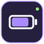
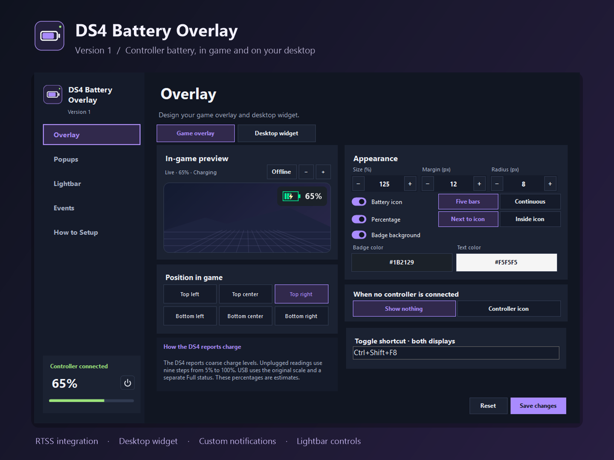
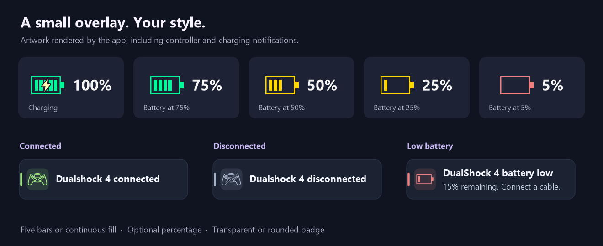
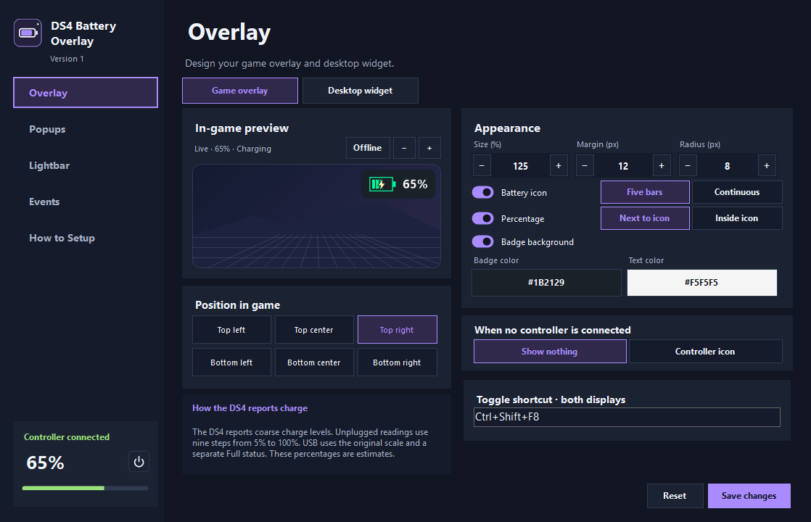
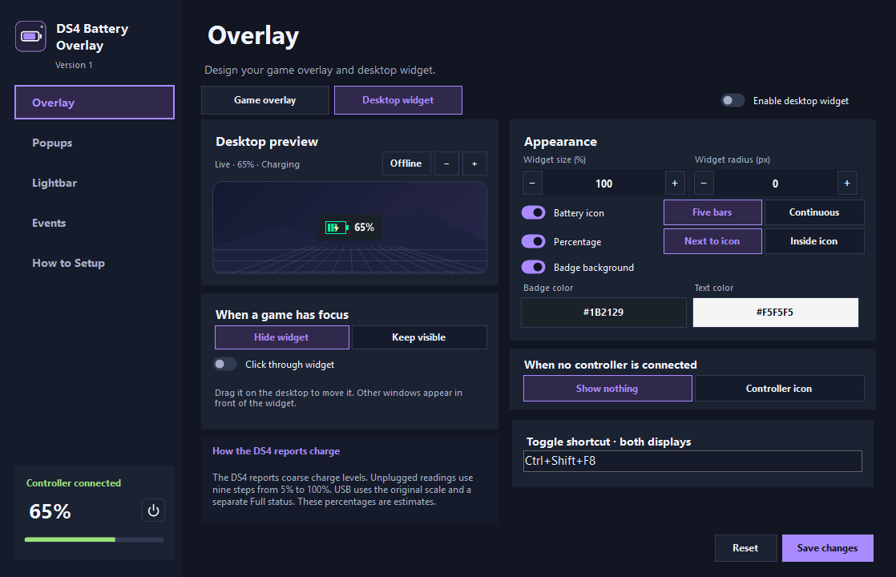
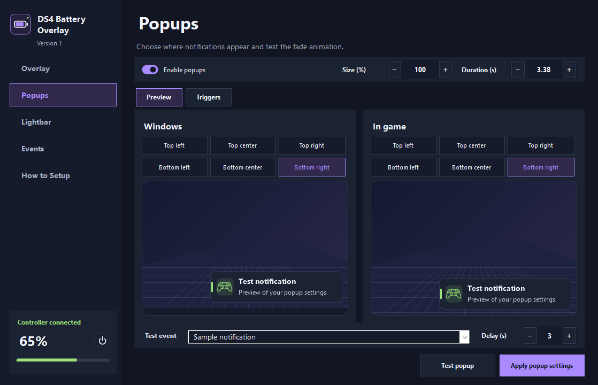
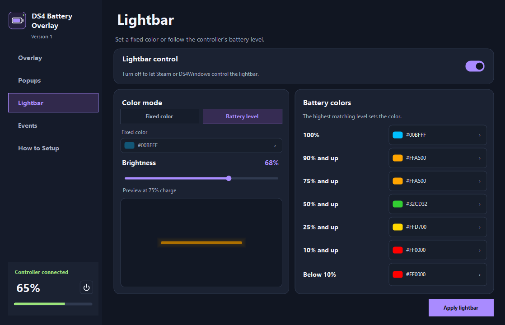
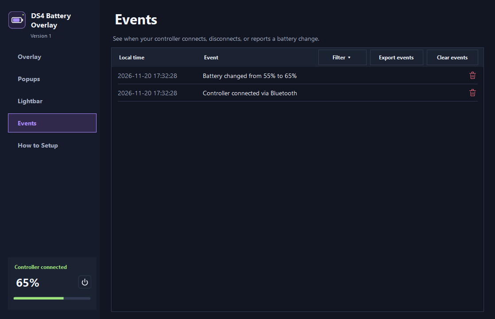
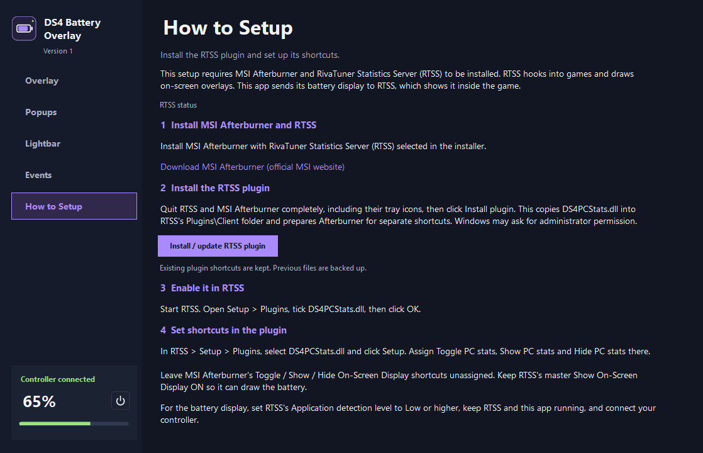

<p align="center">
  
</p>

<h1 align="center">DS4 Battery Overlay</h1>

<p align="center">Your controller's battery, right where you need it.</p>

<p align="center">
  
  
  
  <a href="LICENSE"></a>
</p>



A lightweight Windows app that shows your DualShock 4 battery in games through **RivaTuner Statistics Server (RTSS)**. Add a movable desktop widget, choose when notifications appear, and personalize the controller's lightbar—all from one interface.

**[Get started](#getting-started)** · **[Screenshots](#screenshots)** · **[Build from source](#build-from-source)** · **[Troubleshooting](docs/TROUBLESHOOTING.md)**

## Features

- **In-game battery overlay** with RTSS handling the game integration. Compatibility follows RTSS's support for the game and its graphics API.
- **Your choice of style:** five battery bars or a continuous fill, percentage inside or beside the icon, charging bolt, custom colors, rounded badge, or transparent background.
- **Independent desktop widget** with its own appearance, drag positioning, optional click-through, and hide/keep behavior when a game has focus.
- **Custom notifications** for connection, disconnection, charging, low battery, and selected charge levels. Change their size, position, and duration, or test them after a delay.
- **Lightbar controls** for color, brightness, and battery-based colors. Disable this app's lightbar control when you prefer another app to manage it.
- **Persistent event history** with timestamps, filters, individual deletion, and export of the currently filtered events.
- **Tray controls:** live battery icon, startup option, and Bluetooth controller power-off. Hold PS for eight seconds for the same power-off action while this app is running.
- **Separate shortcuts** for the battery display and PC statistics through the included RTSS client plugin.



## Getting started

### Requirements

- Windows 10 or 11, **64-bit**, with .NET Framework 4.8.
- A DualShock 4 connected over Bluetooth or USB and visible to this app.
- **MSI Afterburner and RTSS**, installed separately. Select RivaTuner Statistics Server in the Afterburner installer: **[official MSI Afterburner download](https://www.msi.com/Landing/afterburner)**.

### Setup

1. Download the Windows ZIP from this repository's **Releases** section, extract it to a permanent folder, and run `DS4-Battery-Overlay.exe`.
2. Quit RTSS and MSI Afterburner completely, including their tray icons. In this app, open **How to Setup → Install / update RTSS plugin**. Accept the Windows administrator prompt.
3. Start RTSS. Open **Setup → Plugins**, enable **DS4PCStats.dll**, and click **OK**.
4. Select that plugin and open **Setup** to assign **Toggle PC stats**, **Show PC stats**, and **Hide PC stats**. Leave Afterburner's global OSD shortcuts unassigned and RTSS's master **Show On-Screen Display** switched on.
5. Keep RTSS and DS4 Battery Overlay running, set RTSS's **Application detection level** to **Low** or higher for the game, and connect your controller.

The battery shortcut defaults to **Ctrl + Shift + F8** and can be changed on the Overlay page. Click the tray icon to bring the app forward; right-click it for quick actions.

The app embeds its own plugin, so the install button does not require you to copy a DLL manually. It preserves existing plugin shortcuts, backs up changed files, and prepares Afterburner's output for independent PC-stat controls. See [what the installer changes](docs/ARCHITECTURE.md#plugin-installation).

## Screenshots

These are previews rendered by the Version 1 interface using demonstration readings.

| Game overlay | Desktop widget |
| --- | --- |
|  |  |

| Popups | Lightbar |
| --- | --- |
|  |  |

| Events | How to Setup |
| --- | --- |
|  |  |

## About the battery percentage

The DS4 reports **coarse charge levels**, not an exact percentage. This app converts those levels to estimates:

| Connection | Displayed levels |
| --- | --- |
| Bluetooth / unplugged | 5, 12, 25, 37, 50, 62, 75, 87, 100% |
| USB-powered | 5, 15, 25, 35, 45, 55, 65, 75, 85, 95, 100%, plus a separate Full state |

A reading can change when plugging in or unplugging without the actual charge changing that quickly. Low-battery warnings occur at **20% or below** when enabled. The [decoder source](src/App/Ds4BatteryScale.cs) defines the exact mapping.

## Build from source

Install **Visual Studio 2022 Build Tools** with **Desktop development with C++**, the MSVC x86/x64 tools, and a Windows SDK. The .NET Framework C# compiler must also be available; the build script checks for it.

In PowerShell, from the repository root:

```powershell
.\Build.ps1 -RunTests -Package
```

The script builds the **x86 RTSS plugin** and **x64 application**, embeds the plugin and artwork, runs the checks, and creates:

```text
artifacts/app/DS4-Battery-Overlay.exe
dist/DS4-Battery-Overlay-v1.0-win-x64.zip
dist/DS4-Battery-Overlay-v1.0-win-x64.zip.sha256
```

Use `./Build.ps1` for a build without tests or packaging. No NuGet dependencies, SDK downloads, original workspace, or prebuilt project binaries are required. Tests use simulated reports and isolated shared-memory fixtures; they do not send commands to your controller or install the plugin.

See [BUILDING.md](docs/BUILDING.md) for the source layout, test details, screenshot generation, and GitHub publishing steps. GitHub Actions builds and tests pushes and pull requests, and produces downloadable Windows artifacts.

## How it works

```text
DualShock 4 → Windows HID reports → DS4 Battery Overlay → RTSS → game
                                            └──────────→ desktop widget / popups
```

Windows supplies controller input reports. The app reads their battery status, renders the artwork, and publishes it to RTSS. **RTSS performs the game hooking**; this version does not place overlay DLLs beside game executables. The included `DS4PCStats.dll` is loaded by RTSS itself to give PC statistics their own visibility controls.

See [Architecture](docs/ARCHITECTURE.md) for implementation details and [Troubleshooting](docs/TROUBLESHOOTING.md) for setup issues and known limitations.

## Updates and settings

Quit the app before replacing the executable in the same folder. Settings and event history are kept separately and survive updates. Windows startup is opt-in and points to the executable's current location, so keep it in a permanent folder.

For compatibility with earlier development builds, settings use `HKEY_CURRENT_USER\Software\DS4OverlayRTSSTest`, and event history uses `%LOCALAPPDATA%\DS4OverlayRTSSTest\controller-events.log`.

## Contributing

Bug reports and focused improvements are welcome. Include your app version, controller connection type, RTSS version, and steps to reproduce. For overlay problems, include the game and graphics API if known. See [CONTRIBUTING.md](CONTRIBUTING.md).

## License

[MIT](LICENSE). RTSS and MSI Afterburner are external dependencies with their own terms and are not bundled. This is an independent project, not affiliated with Sony, MSI, or the RTSS developer. See [third-party notices](THIRD-PARTY-NOTICES.md).
